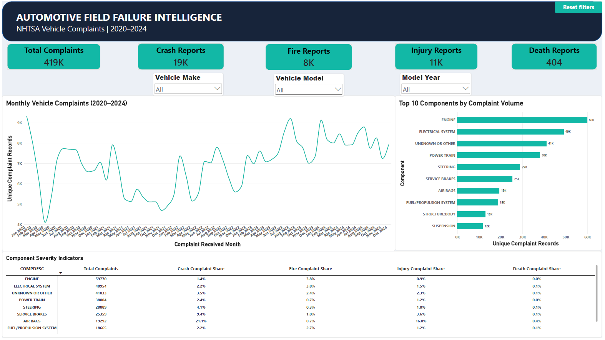
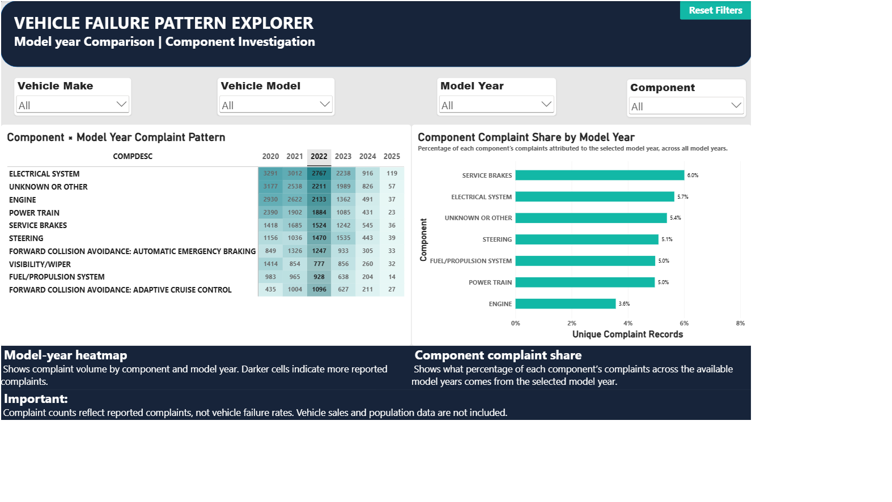

# 🚗 Automotive Field Failure Intelligence

**Exploring automotive complaint patterns using SQL, Python, and Power BI**

[](./sql/)
[](./python/)
[](./powerbi/)

## 📌 Project Overview

Working in automotive R&D gave me an interest in understanding what happens after a vehicle reaches the customer. Beyond designing and developing components, complaint data can help identify recurring patterns and areas that may need further investigation.

This project analyzes vehicle complaints reported to the **U.S. National Highway Traffic Safety Administration (NHTSA)** from 2020 to 2024. I used SQL to investigate complaint trends and component patterns, Python to explore complaint narratives, and Power BI to present the findings in an interactive report.

The analysis covers **418,884 complaint records** and focuses on component distribution, model-year patterns, and reported safety indicators.

## 📖 Dataset
The raw dataset is not included in this repository. 

Link: https://static.nhtsa.gov/odi/ffdd/cmpl/COMPLAINTS_RECEIVED_2020-2024.zip

## 🎯 Business Objectives

- Identify the automotive components most frequently mentioned in complaints.
- Examine how complaint volumes change over time.
- Compare component complaint patterns across vehicle model years.
- Explore reported crash, fire, injury, and death indicators.
- Investigate complaint narratives for recurring terms that may warrant further analysis.
- Convert the analysis into a dashboard that makes the findings easier to explore.

## 🛠️ Tools & Technologies

| Tool | How it was used |
|---|---|
| SQL Server | Data profiling, aggregation, trend analysis, and targeted investigations |
| Python | Exploratory analysis of complaint narratives and keyword patterns |
| Power BI | Interactive dashboards, KPI cards, trend charts, and component/model-year comparisons |

## 📊 Power BI Dashboard

The report is organized into two pages, moving from an overall view of the data to a more focused investigation.

### 1. Executive Overview



**What this page tells us**

- **Overall complaint volume:** The total number of complaint records included in the analysis.
- **Reported safety indicators:** Complaint records marked for crashes, fires, injuries, and deaths.
- **Complaint trends:** How complaint volumes changed from month to month over the selected period.
- **Frequently reported components:** Which component categories account for the largest complaint counts.
- **Component and safety overview:** A comparison of component complaint volumes alongside selected safety indicators.

The page provides a starting point for identifying areas that may deserve a closer look. Slicers allow the results to be explored by available vehicle attributes, such as make, model, and model year.

### 2. Component & Vehicle Investigation



**What this page tells us**

- **Component distribution by model year:** The heatmap makes it easier to compare complaint counts across component categories and vehicle model years.
- **Model-year contribution within a component:** The accompanying bar chart shows what proportion of a selected component's complaints comes from the selected model year.
- **Areas for further investigation:** Components and model years with notable complaint counts or shares can be examined more closely.

This page moves beyond overall counts to explore how complaint patterns differ across vehicle model years. Comparisons should still account for differences in vehicle population and time in service.

## 🔍 Key Findings

The following findings are based on the profiled dataset and exploratory analysis.

### Complaint trends

Annual complaint counts by complaint received date (`LDATE`) were:

| Year | Complaint records |
|---|---:|
| 2020 | 83,356 |
| 2021 | 69,128 |
| 2022 | 76,628 |
| 2023 | 91,757 |
| 2024 | 98,015 |

Complaint counts declined in 2021 and increased in each subsequent year through 2024. This describes the records in the dataset; it does not by itself establish a change in the underlying vehicle failure rate.

### Component patterns

Engine complaints were the largest group among the component categories examined in the annual comparison. Electrical system and power train complaints were also prominent.

These patterns can help prioritize further investigation, but complaint frequency alone does not establish component reliability.

### Data completeness

Mileage (`MILES`) was missing in approximately **64% of records** in the initial data profile. This limits the usefulness of mileage-based comparisons and highlights why data quality needs to be assessed before drawing conclusions.

### Exploratory narrative analysis

For Ford Escape engine complaints associated with model years 2017–2019, approximately **71.1% of the selected complaint narratives contained coolant-related keywords**.

This finding identifies a recurring text pattern worth investigating. It does not confirm that every complaint describes the same mechanical issue or that any particular vehicle is covered by a manufacturer service program.

## 🔄 Analysis Workflow

1. **Data preparation and profiling**  
   Imported the complaint dataset into SQL Server and reviewed record counts, identifier uniqueness, date coverage, and data completeness.

2. **SQL investigation**  
   Analyzed complaint trends, component distribution, model-year patterns, and reported safety indicators.

3. **Python exploration**  
   Examined selected complaint narratives using keyword-based analysis to identify recurring terms and potential patterns for further investigation.

4. **Power BI reporting**  
   Built a two-page interactive report to present the overall complaint picture and support component/model-year comparisons.

## ⚠️ Data Limitations

The results need to be interpreted within the limits of the source data.

- **Complaints are not confirmed failures.** NHTSA complaint records are reports and may not represent independently verified defects.
- **Counts are not failure rates.** The dataset does not provide a reliable vehicle-population denominator for calculating failure rates.
- **Missing values matter.** Fields such as mileage are incomplete, which restricts some analyses.
- **Model years have different exposure periods.** Newer vehicles have had less time in service and less time to accumulate complaints.
- **Keyword matches are exploratory.** Narrative searches can miss relevant descriptions or match terms that do not indicate the same underlying problem.
- **Safety indicators reflect reported information.** They should not automatically be interpreted as verified outcomes or proof of causation.

## 📁 Repository Structure

```text
automotive-field-failure-intelligence/
├── dataset/
│   └── raw.txt
│   └── Import_Instructions_Excel_5-year.pdf
├── powerbi/
│   └── automotive_Field_Failure_Intelligence.pbix
├── notebooks/
│   └── 01_Data_profiling.ipynb
│   └── 02_Complaint_analysis.ipynb
├── sql/
│   └── analysis_queries.sql
└── screenshots/
    ├── executive_overview.png
    └── component_investigation.png
├── README.md
```

The filenames above are the intended structure. Update them to match the actual files committed to the repository.

## 🚀 How to Explore

1. Open the Power BI report to explore complaint trends and component/model-year patterns.
2. Review the SQL script to see how the dataset was queried and investigated.
3. Explore the Python notebook for the narrative analysis and supporting investigation.


## 💡 What I Learned

This project helped me connect my automotive engineering background with practical automotive warranty data analysis. It reinforced the importance of checking data quality, choosing the right comparisons, and separating observed patterns from conclusions that the data cannot support.

It also gave me an opportunity to take an automotive problem area from database analysis through exploratory investigation and interactive reporting.

---

**Author:** Vaibhav Sharma  
**Focus:** Automotive Warranty Data Analytics | SQL | Python | Power BI
