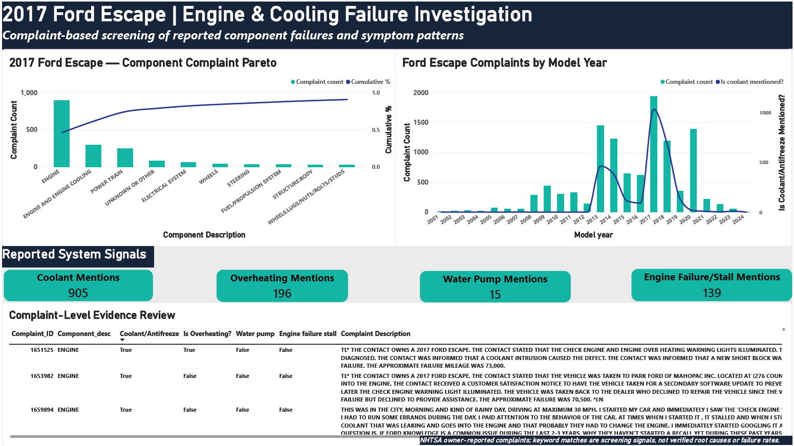
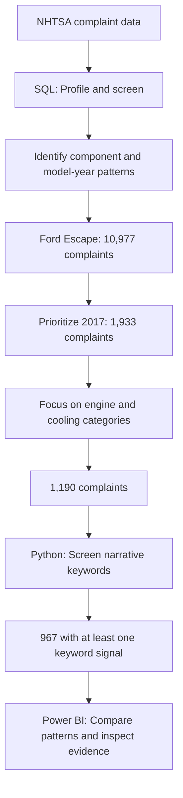

# 🚗 Automotive Field Failure Intelligence

**Exploring automotive complaint patterns using SQL, Python, and Power BI**

[](./sql/)
[](./python/)
[](./powerbi/)

## 📌 Project Overview

Working in automotive R&D gave me an interest in understanding what happens after a vehicle reaches the customer. Beyond designing and developing components, complaint data can help identify recurring patterns and areas that may need further investigation.

This project analyzes 418,884 NHTSA vehicle complaint records received during 2020–2024. I used SQL Server for structured analysis, Python to explore complaint narratives, and Power BI to turn the findings into an interactive report.

The project combines a broad complaint overview with a focused investigation of engine and cooling complaints for the 2017 Ford Escape.

## 📖 Dataset
The raw dataset is not included in this repository. 

Link: https://static.nhtsa.gov/odi/ffdd/cmpl/COMPLAINTS_RECEIVED_2020-2024.zip

### Data Source and Column Definitions

This project uses NHTSA vehicle complaint records for exploratory automotive field-failure analysis.

The dataset's accompanying import-instructions document contains **Appendix A**, which describes the source columns and their meanings.

- **Source documentation:** [Import Instructions PDF](dataset/Import_Instructions_Excel_5-year.pdf)
- **Project data dictionary:** Refer Appendix A of Source documentation for column name, column type and column description

The data dictionary summarises the fields used in the analysis, including complaint identifiers, vehicle model information, component descriptions, complaint narratives, dates, mileage and reported safety indicators.

NHTSA complaints are reports and should not be treated as confirmed failures. Complaint counts alone do not establish failure rates without suitable vehicle-population or exposure data.

## 🎯 Business Objectives

Identify component and model-year complaint patterns that warrant closer investigation, then connect those patterns to reported symptoms and individual complaint narratives.

## 🛠️ Tools & Technologies

| Tool | How it was used |
|---|---|
| SQL Server | Data profiling, aggregation, trend analysis, and targeted investigations |
| Python/Pandas | Narrative preprocessing, keyword-based symptom screening, and export preparation |
| Jupyter Notebook | Documented the analysis and investigation steps |
| Power BI | Interactive dashboards, KPI cards, trend charts, and component/model-year comparisons |

## 📊 Power BI Dashboard

The report is organized into three pages, moving from an overall view of the data to a more focused investigation.

### 1. Executive Overview


**What this page tells us**

- **Overall complaint volume:** The total number of complaint records included in the analysis.
- **Reported safety indicators:** Complaint records marked for crashes, fires, injuries, and deaths.
- **Complaint trends:** How complaint volumes changed from month to month over the selected period.
- **Frequently reported components:** Which component categories account for the largest complaint counts.
- **Component and safety overview:** A comparison of component complaint volumes alongside selected safety indicators.

The page provides a starting point for identifying areas that may deserve a closer look. Slicers allow the results to be explored by available vehicle attributes, such as make, model, and model year.

### 2. Component & Vehicle Investigation


**What this page tells us**

- **Component distribution by model year:** The heatmap makes it easier to compare complaint counts across component categories and vehicle model years.
- **Model-year contribution within a component:** The accompanying bar chart shows what proportion of a selected component's complaints comes from the selected model year.
- **Areas for further investigation:** Components and model years with notable complaint counts or shares can be examined more closely.

This page moves beyond overall counts to explore how complaint patterns differ across vehicle model years. Comparisons should still account for differences in vehicle population and time in service.

### 3. Engine & Cooling Investigation



**What this page tells us**

-Focuses on the 2017 Ford Escape cohort and connects the aggregate analysis to the underlying reports through:
--Component complaint Pareto and cumulative contribution.
--Ford Escape model-year complaint trend.
--Four symptom keyword KPI cards.
--Complaint-level table with component descriptions, symptom flags, signal counts, and narratives.

## 🔍 Key Findings

The following findings are based on the profiled dataset and exploratory analysis.

### Complaint trends

Annual complaint counts by complaint received date (`LDATE`) were:

| Year | Complaint records |
|---|---:|
| 2020 | 83,356 |
| 2021 | 69,128 |
| 2022 | 76,628 |
| 2023 | 91,757 |
| 2024 | 98,015 |

Complaint counts declined in 2021 and increased in each subsequent year through 2024. This describes the records in the dataset; it does not by itself establish a change in the underlying vehicle failure rate.

### Component patterns

Engine complaints were the largest group among the component categories examined in the annual comparison. Electrical system and power train complaints were also prominent.

These patterns can help prioritize further investigation, but complaint frequency alone does not establish component reliability.

### Data completeness

Mileage (`MILES`) was missing in approximately **64% of records** in the initial data profile. This limits the usefulness of mileage-based comparisons and highlights why data quality needs to be assessed before drawing conclusions.


### Focused Ford Escape investigation
The focused analysis uses vehicle model years 2001–2024, which is a different time dimension from the complaint-received period above.

| Investigation stage | Finding |
|---|---:|
| Ford Escape cohort | 10,977 distinct complaints |
| 2017 model year | 1,933 complaints |
| Engine and Engine and Engine Cooling categories | 1,190 complaints |
| Complaints matching at least one selected keyword group | 967 |
| Coolant/antifreeze keyword matches within the 1,190-complaint cohort | 905 |

The top three component categories accounted for approximately **74.39%** of the 2017 cohort.

These findings help prioritize further review of engine and cooling complaints. They do not confirm a shared root cause or establish a vehicle failure rate.


## 🔄 Analysis Workflow

1. **Data preparation and profiling**  
   Imported the complaint dataset into SQL Server and reviewed record counts, identifier uniqueness, date coverage, and data completeness.

2. **SQL investigation**  
   Analyzed complaint trends, component distribution, model-year patterns, and reported safety indicators.

3. **Python exploration**  
   Examined selected complaint narratives using keyword-based analysis to identify recurring terms and potential patterns for further investigation.

4. **Power BI reporting**  
   Built a three-page interactive report to present the overall complaint picture and support component/model-year comparisons.


**Why this approach?** I narrowed the dataset in stages so the investigation remained focused and traceable. The 2017 cohort was selected because it had the highest raw complaint count among the analyzed Ford Escape model years. Python then helped identify recurring symptom language, while Power BI connected the aggregate results to individual complaints.

## ⚠️ Data Limitations

The results need to be interpreted within the limits of the source data.

- **Complaints are not confirmed failures.** NHTSA complaint records are reports and may not represent independently verified defects.
- **Counts are not failure rates.** The dataset does not provide a reliable vehicle-population denominator for calculating failure rates.
- **Missing values matter.** Fields such as mileage are incomplete, which restricts some analyses.
- **Model years have different exposure periods.** Newer vehicles have had less time in service and less time to accumulate complaints.
- **Keyword matches are exploratory.** Narrative searches can miss relevant descriptions or match terms that do not indicate the same underlying problem.
- **Safety indicators reflect reported information.** They should not automatically be interpreted as verified outcomes or proof of causation.

## 📁 Repository Structure

```text
automotive-field-failure-intelligence/
├── dataset/
│   └── Import_Instructions_Excel_5-year.pdf
├── notebooks/
│   ├── 01_Data_profiling.ipynb
│   └── 02_Complaint_analysis.ipynb
├── sql/
│   └── analysis_queries.sql
├── powerbi/
│   ├── automotive_Field_Failure_Intelligence.pbix
│   └── powerbi_exports/
│       ├── ford_escape_model_year_trend.csv
│       ├── ford_escape_2017_component_pareto.csv
│       └── ford_escape_2017_investigation.csv
├── screenshots/
│   ├── executive_overview.png
│   ├── vehicle_investigation.png
│   └── engine_cooling_investigation.png
├── LICENSE
└── README.md
```

## 🚀 How to Explore

1. **Power BI:** Start with the report to understand the findings and focused investigation.
2. **SQL:** Review `analysis_queries.sql` to follow the screening, cohort selection, and validation.
3. **Python:** Explore the notebooks for data profiling, narrative screening, and export preparation.
4. **CSV exports:** Inspect the prepared tables used by the focused dashboard page.


## 💡 What I Learned

This project helped me apply my automotive engineering background to a structured analytics workflow: defining an investigation, narrowing the data, validating counts across SQL and Python, examining unstructured narratives, and presenting traceable findings in Power BI.

It also reinforced the importance of separating observed patterns from conclusions that the data cannot support.

---

**Author:** Vaibhav Sharma  
**Focus:** Automotive Field Quality | Warranty Analytics | SQL | Python | Power BI
